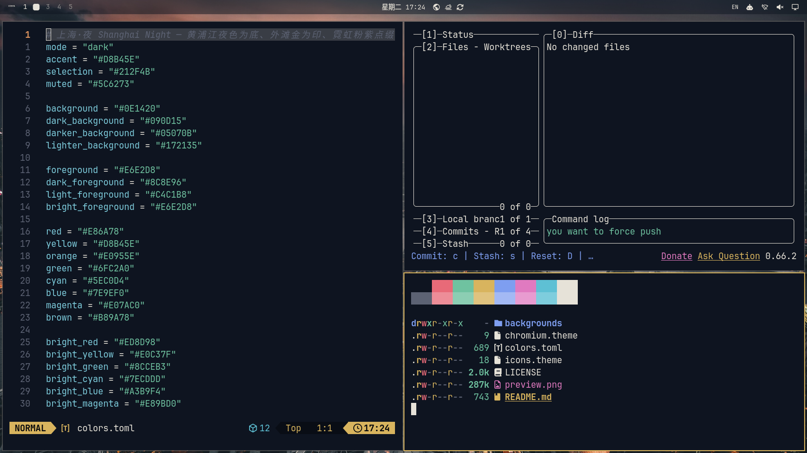

# 上海·夜 Shanghai Night

黄浦江夜色为底、外滩金为印、霓虹粉紫点缀的深色主题。壁纸：陆家嘴与浦东夜色。



## 安装

```bash
omarchy theme install https://github.com/rwanglq-ctrl/omarchy-shanghai-night-theme
```

## 壁纸来源

1. [陆家嘴与黄浦江暮色俯瞰](https://unsplash.com/photos/shanghai-skyline-and-huangpu-river-D8iZPlX-2fs) — Denys Nevozhai，Unsplash License（Unsplash）
2. [浦东夜色倒影](https://unsplash.com/photos/architectural-photograph-of-lighted-city-sky-5h_dMuX_7RE) — Li Yang，Unsplash License（Unsplash）

## 许可

- 壁纸：Unsplash 照片依 Unsplash License 使用
- 配色与配置文件：MIT

详见 [LICENSE](LICENSE)。
